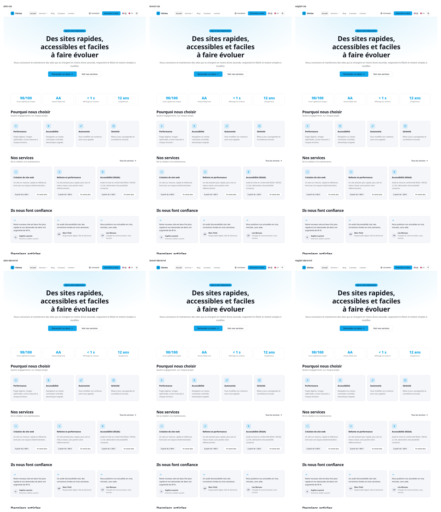

# AlphaRust (English summary)

*The full guide is in French: [README.md](README.md). Changes: [CHANGELOG.md](CHANGELOG.md).*

**AlphaRust** is a single Rust binary with three interfaces (**CLI**, **TUI**, **web GUI**) on one engine:

1. **Quality checks** for a repository: 98 rules (regex and semantic checkers) self-tested by their examples,
   8 profiles, `.alpharust.toml` configuration, cache, **SARIF 2.1.0** output for GitHub code scanning.
2. **Project generation** with the **official tools** (`create-astro`, `composer create-project`, `wagtail start`,
   `cargo new`), real dependency installation, a template layer on top, then **verification** (types, build, tests, lint).
3. **The same marketing site** in **Astro, Laravel or Wagtail**, with **two design kits** (Tailwind + Starwind or plain
   CSS): **6 combinations** that render the same, in **French, English, Spanish and Arabic** (RTL), with optional
   **user accounts** (Better Auth, Laravel Fortify, Django auth), identical SEO and the same baseline CSP in production.



## Install

```bash
# Linux and macOS
curl --proto '=https' --tlsv1.2 -LsSf https://github.com/Ishaq74/alpharust/releases/latest/download/alpharust-installer.sh | sh
# Windows (PowerShell)
powershell -ExecutionPolicy Bypass -c "irm https://github.com/Ishaq74/alpharust/releases/latest/download/alpharust-installer.ps1 | iex"
# with Rust 1.89+
cargo install --locked --git https://github.com/Ishaq74/alpharust --tag v0.3.0
# from source
git clone https://github.com/Ishaq74/alpharust.git && cd alpharust && cargo build --release
```

Prebuilt archives (Linux x86_64/arm64, macOS Intel/Apple Silicon, Windows x86_64, with SHA-256 checksums) are on the
[releases page](https://github.com/Ishaq74/alpharust/releases). `alpharust doctor` lists the tools each framework needs.

## Quick start

```bash
alpharust lint . --profile strict                          # check the current folder
alpharust generate astro   site --ui starwind --db sqlite --auth --langs fr,en,es,ar
alpharust generate laravel site --ui css --auth
alpharust generate wagtail site --ui starwind --langs fr,ar
alpharust new                                              # interactive wizard
alpharust gui                                              # http://127.0.0.1:3000
```

Common `generate` options: `-p/--path`, `--force` (only replaces an AlphaRust project), `--no-install`, `--no-verify`,
`--no-git`, `--dry-run` (exact plan, nothing written), `--json` (one event per line). Languages use a single option,
`--langs` (French is the default, unprefixed language; `--i18n` is a deprecated alias). Official tool versions are
pinned in `src/scaffold/pins.rs`.

## Production

* **SEO** on all 6 combinations: canonical, `hreflang` alternates + `x-default`, Open Graph, JSON-LD `Organization` and
  `BlogPosting`, `robots.txt`, multilingual `sitemap.xml`.
* **Baseline CSP**, production only: Astro `<meta>` in the layout, Laravel `SecurityHeaders` middleware, Django 6
  built-in CSP middleware.
* **Wagtail** gets a hardened `settings/production.py` following the Django deployment checklist
  (`DJANGO_SECRET_KEY` and `DJANGO_ALLOWED_HOSTS` required, HTTPS redirect, secure cookies, HSTS).

## Quality gates

* CI: fmt, clippy `-D warnings`, tests on Linux, Windows and macOS, MSRV 1.89, `cargo deny`, `cargo package`,
  `tools/dsgen` regeneration + ruff + pytest, real generations of every framework.
* Nightly: the 6 combinations × 4 languages with `--auth`: structure/SEO/pixel parity, account flows and axe-core
  (WCAG 2.1 AA, light and dark), screenshots uploaded as artifacts.
* Releases: cargo-dist builds binaries and shell/PowerShell installers for every `v*` tag.

Architecture decisions are in [`adr/`](adr/README.md) (latest: [0018](adr/0018-audit-quality-release-0-3.md)).
License: see [LICENSE](LICENSE).
