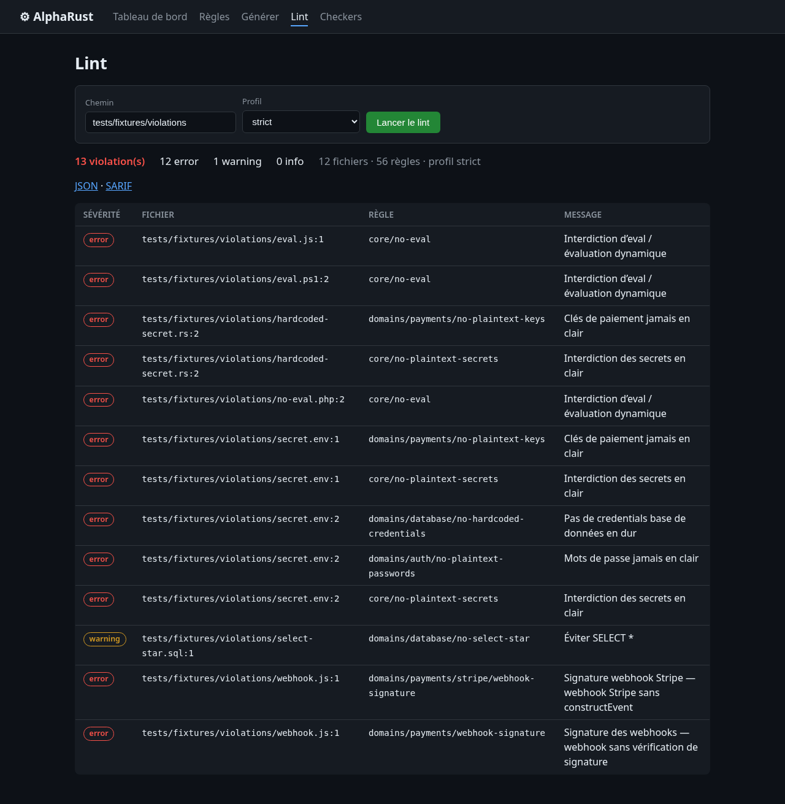
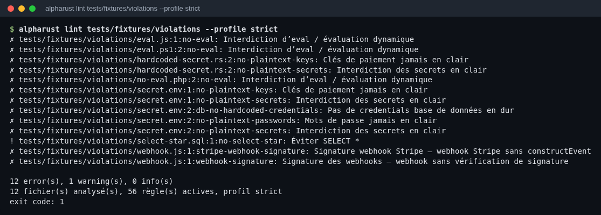
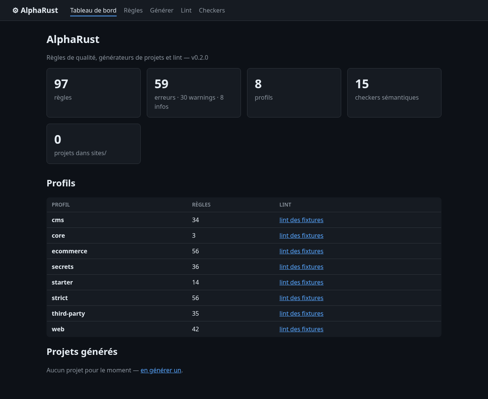

# AlphaRust

Fondation de qualité pour vos projets : **97 règles** (regex et analyses sémantiques) auto-testées, **8 profils**,
**générateurs** de projets complets (Wagtail, Astro, Laravel, Rust) et trois interfaces — **CLI, TUI et GUI web** —
sur un même moteur. Sortie **SARIF 2.1.0** pour le code scanning GitHub.



## Installation

Prérequis : Rust ≥ 1.85.

```bash
git clone https://github.com/Ishaq74/alpharust.git
cd alpharust
cargo build --release
./target/release/alpharust list
```

`alpharust` retrouve `rules/`, `profiles/` et `sites/` depuis n'importe quel dossier (voir `ALPHARUST_HOME`, `docs/cli.md`).

## Usage

### CLI

```bash
alpharust lint                         # lint du dossier courant (config .alpharust.toml)
alpharust lint src --profile strict    # un profil (alpharust list --profiles)
alpharust lint --sarif > out.sarif     # SARIF 2.1.0
alpharust lint --json --fail-on warning
alpharust list                         # règles ; --profiles ; --checkers
alpharust check-rules                  # valide règles, exemples et profils
alpharust generate wagtail mon-cms     # aussi : astro, laravel ; init <nom> pour Rust
alpharust generate astro mon-site --path ./autre --force
alpharust cache status                 # cache des règles ; cache clear
```

Codes de sortie : `0` OK · `1` violations au-dessus du seuil · `2` erreur. Détails : [`docs/cli.md`](docs/cli.md).



### TUI

```bash
alpharust tui
```

Menu interactif (lint, génération, listes), changement de profil avec `p`, résultats défilables.
Voir [`docs/interfaces.md`](docs/interfaces.md).


### GUI web

```bash
alpharust gui            # http://127.0.0.1:3000
```

Tableau de bord, règles (filtrables), détail d'une règle, checkers, génération de projets, lint avec résultats
détaillés, API JSON/SARIF. Écoute uniquement sur `127.0.0.1`.




## Fonctionnalités

- **Règles** Markdown + frontmatter YAML (`rules/`), validées et auto-testées par leurs exemples — [`docs/rule-format.md`](docs/rule-format.md), [`docs/writing-rules.md`](docs/writing-rules.md).
- **Checkers sémantiques** : HTML (alt, lang, titres, sémantique), Markdown, contraste CSS WCAG, lexer Rust (`unsafe`), indentation, cohérence des dépendances, compagnons requis, présence de fichiers — [`docs/checks.md`](docs/checks.md).
- **Tiers** : secrets et mauvaises configurations pour AWS, GCP, GitHub, Slack, OpenAI, Twilio, Azure, SendGrid, Postmark, Brevo, Stripe, Adyen, Square, Braintree, Paddle, Auth0, Clerk, Supabase, Firebase, MongoDB, Redis, PlanetScale…
- **Profils** (`core`, `starter`, `strict`, `web`, `ecommerce`, `cms`, `secrets`, `third-party`) — [`docs/profiles.md`](docs/profiles.md).
- **Configuration** `.alpharust.toml` (profil, exclusions, désactivation, sévérités, `fail_on`), suppression `alpharust-ignore`, **cache** des règles — [`docs/configuration.md`](docs/configuration.md).
- **Générateurs** de projets exécutables et testés en CI — [`docs/generators.md`](docs/generators.md).


## Développement

```bash
cargo fmt --check
cargo clippy --all-targets -- -D warnings
cargo test --all-targets
./target/release/alpharust check-rules
./target/release/alpharust lint --profile strict     # le dépôt passe son propre lint
```

La CI (`.github/workflows/ci.yml`) exécute ces étapes, puis génère et teste des projets Wagtail, Astro et Laravel.
Voir [`docs/tests.md`](docs/tests.md), [`docs/arborescence.md`](docs/arborescence.md), les décisions dans [`adr/`](adr/README.md)
(dernier en date : ADR 0010) et la feuille de route dans [`todos/`](todos/).

## License

MIT — voir [`LICENSE`](LICENSE).
