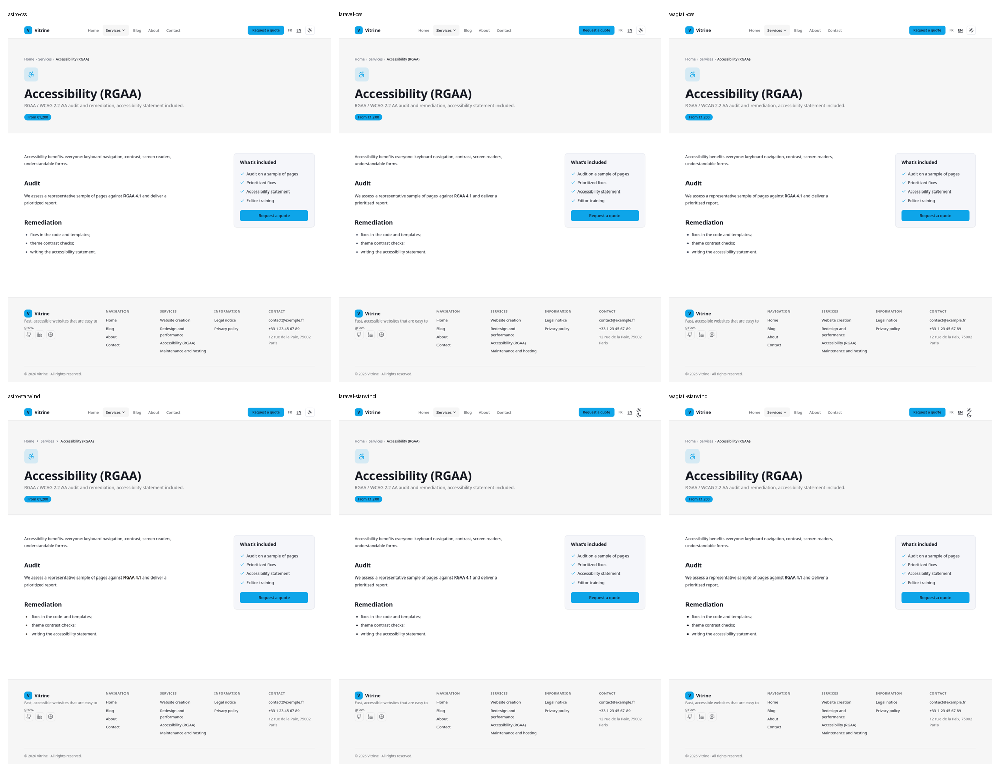
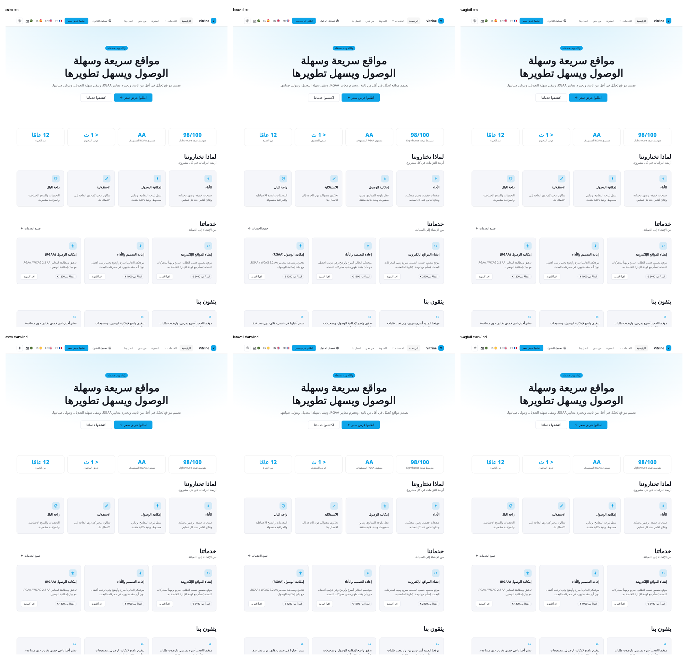
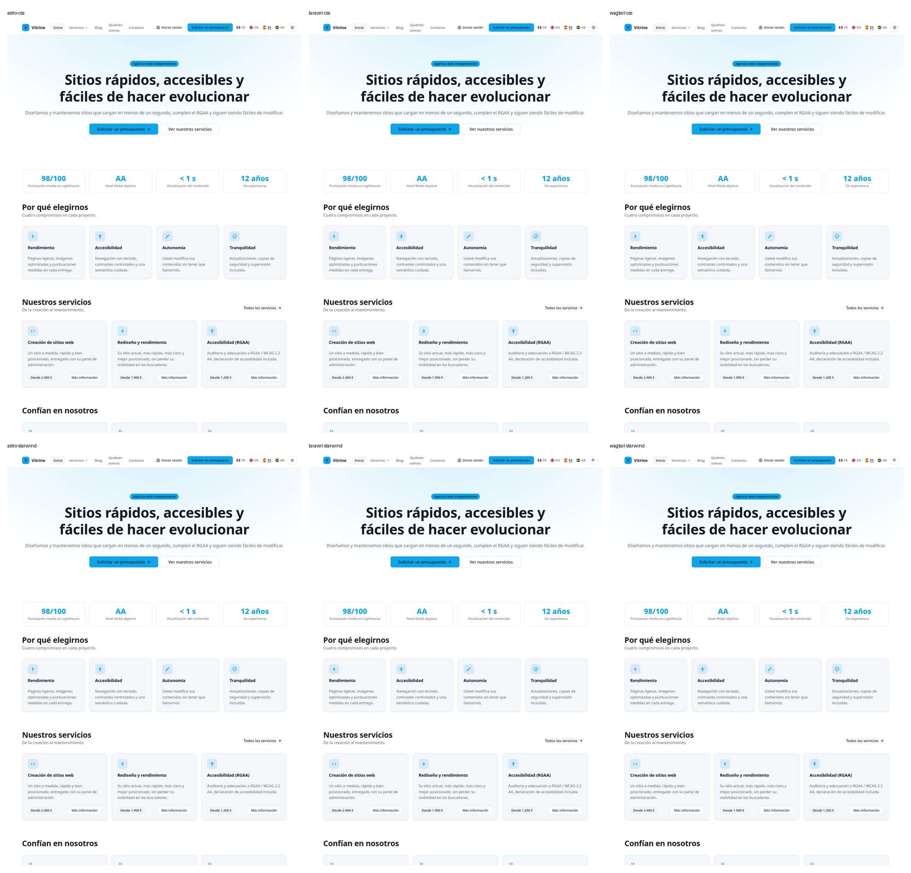
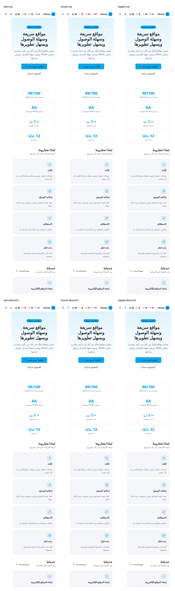
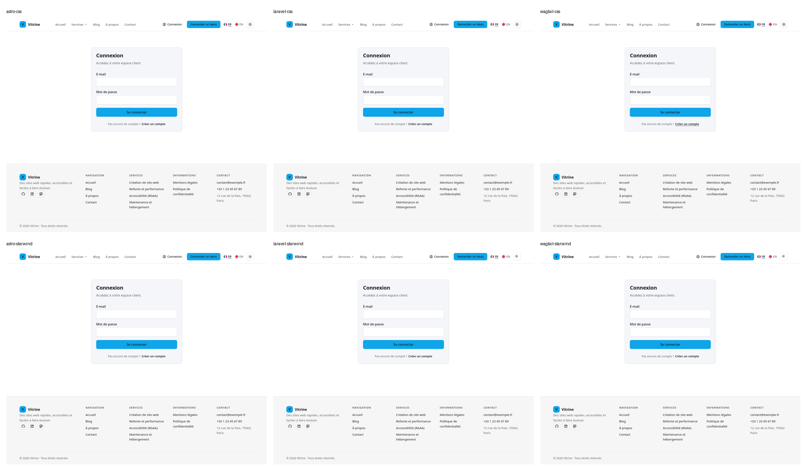
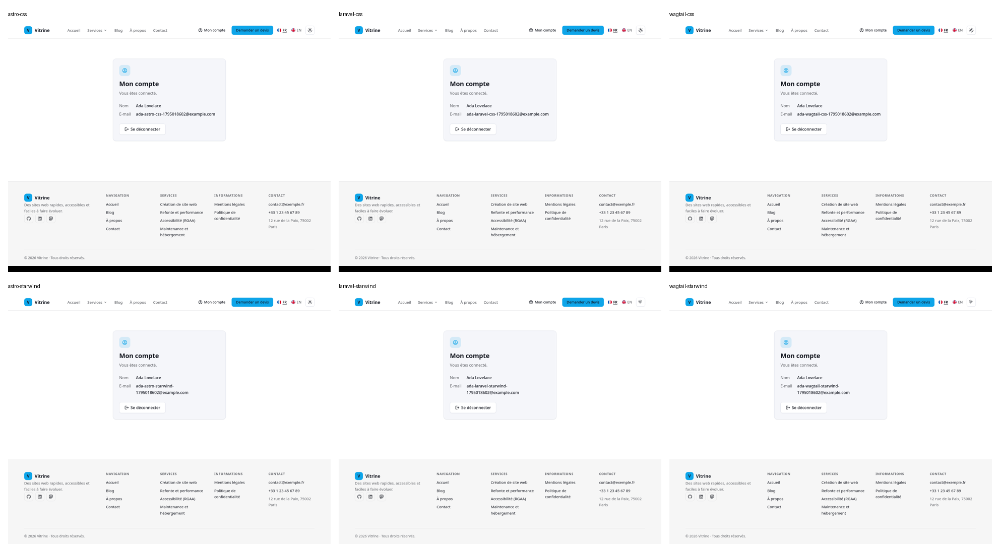
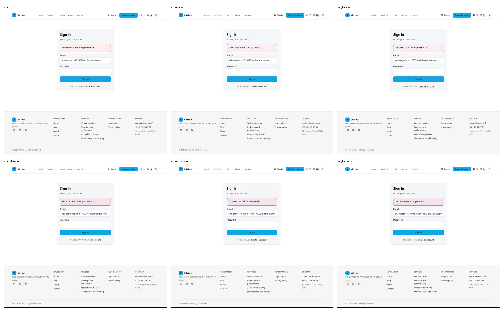
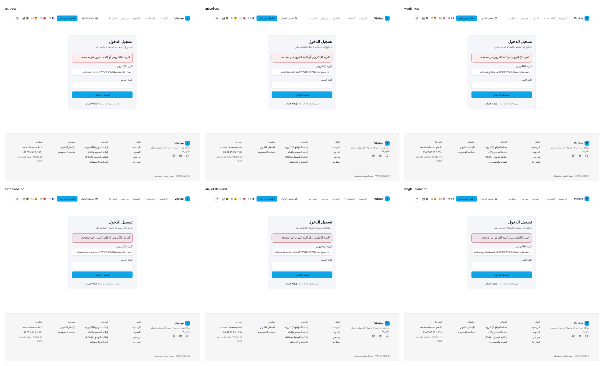

# AlphaRust

**AlphaRust** est un binaire Rust unique qui fait trois choses, avec trois interfaces (**CLI**, **TUI**, **GUI web**) branchées
sur le même moteur :

1. **Vérifier la qualité** d'un dépôt : 98 règles (regex et analyses sémantiques) auto-testées par leurs exemples,
   8 profils, configuration `.alpharust.toml`, cache, sortie **SARIF 2.1.0** pour le code scanning GitHub.
2. **Générer des projets** avec les **outils officiels** (`create-astro`, `composer create-project`, `wagtail start`,
   `cargo new`), installer réellement les dépendances, poser une couche de modèles et **vérifier** le résultat
   (types, build, tests, lint).
3. **Produire le même site vitrine** en **Astro, Laravel ou Wagtail**, avec **deux kits de design** (Tailwind + Starwind
   ou CSS pur) : **6 combinaisons** au rendu identique (écart mesuré ≤ 0,84 % des pixels), en **français, anglais, espagnol et
   arabe** (RTL), au choix avec `--langs`, avec **comptes utilisateurs** (Better Auth, Laravel Fortify, authentification Django).

*English summary: [README.en.md](README.en.md) · Journal des versions : [CHANGELOG.md](CHANGELOG.md)*


---

## Sommaire

- [À qui s'adresse ce guide](#à-qui-sadresse-ce-guide)
- [Prérequis par système](#prérequis-par-système)
- [Installation](#installation)
- [Démarrage rapide (5 minutes)](#démarrage-rapide-5-minutes)
- [Référence des commandes](#référence-des-commandes)
- [Générer des projets](#générer-des-projets)
- [Le site vitrine : 6 combinaisons identiques](#le-site-vitrine--6-combinaisons-identiques)
- [Langues (i18n)](#langues-i18n)
- [Comptes utilisateurs (`--auth`)](#comptes-utilisateurs---auth)
- [Icônes et drapeaux (`--icons`)](#icônes-et-drapeaux---icons)
- [Kits de design, thème et personnalisation](#kits-de-design-thème-et-personnalisation)
- [Orchestrer les projets générés](#orchestrer-les-projets-générés)
- [Lint : règles, profils, configuration, SARIF](#lint--règles-profils-configuration-sarif)
- [TUI et GUI web](#tui-et-gui-web)
- [Architecture](#architecture)
- [`tools/dsgen` : une seule source pour les trois frameworks](#toolsdsgen--une-seule-source-pour-les-trois-frameworks)
- [Contribuer : règles, générateurs, couches](#contribuer--règles-générateurs-couches)
- [Tests, preuves visuelles et CI](#tests-preuves-visuelles-et-ci)
- [Dépannage / FAQ](#dépannage--faq)
- [Documentation et décisions (ADR)](#documentation-et-décisions-adr)

## À qui s'adresse ce guide

| Vous êtes… | Lisez en priorité |
|------------|-------------------|
| **Débutant** : vous voulez un site qui marche | [Prérequis](#prérequis-par-système), [Installation](#installation), [Démarrage rapide](#démarrage-rapide-5-minutes) |
| **Développeur** (CLI, TUI, GUI) | [Référence des commandes](#référence-des-commandes), [Générer des projets](#générer-des-projets), [Orchestrer](#orchestrer-les-projets-générés) |
| **Designer** : couleurs, kit, composants | [Kits de design et thème](#kits-de-design-thème-et-personnalisation), [Icônes](#icônes-et-drapeaux---icons) |
| Utilisateur **Astro**, **Laravel** ou **Wagtail** | [Le site vitrine](#le-site-vitrine--6-combinaisons-identiques) puis la section de votre framework |
| **Contributeur** (règles, générateurs) | [Architecture](#architecture), [dsgen](#toolsdsgen--une-seule-source-pour-les-trois-frameworks), [Contribuer](#contribuer--règles-générateurs-couches) |
| **CI / Ops** | [Lint et SARIF](#lint--règles-profils-configuration-sarif), [Tests et CI](#tests-preuves-visuelles-et-ci), [Variables d'environnement](#variables-denvironnement) |

## Prérequis par système

AlphaRust lui-même n'a besoin que de **Rust ≥ 1.85** (`rust-version` du `Cargo.toml`). Les autres outils ne servent qu'à
**générer** le framework correspondant ; `alpharust doctor` indique ce qui manque et comment l'installer.

| Outil | Version minimale (vérifiée par `doctor`) | Sert à |
|-------|------------------------------------------|--------|
| Rust / Cargo | 1.85 (clippy recommandé) | compiler AlphaRust, générer des projets Rust |
| Git | — | dépôt Git des projets générés (sauf `--no-git`) |
| Node.js + npm (ou pnpm, yarn, bun) | Node 22.12, npm 9.6.5 | Astro ; front Laravel (Vite) |
| PHP + Composer | PHP 8.3 (+ mbstring, openssl, tokenizer, ctype, xml, curl, pdo_sqlite/mysql/pgsql), Composer 2 | Laravel |
| Python (+ `venv`, `ensurepip`) | 3.10 | Wagtail |
| curl | — | Wagtail + Starwind (CLI autonome Tailwind), `--icons` vers un jeu non embarqué |

**Linux (Debian/Ubuntu)**

```bash
curl --proto '=https' --tlsv1.2 -sSf https://sh.rustup.rs | sh        # Rust
sudo apt install git curl python3 python3-venv php php-cli php-mbstring php-xml php-curl php-sqlite3 composer
# Node 22+ : via nvm, fnm ou les paquets NodeSource
```

**macOS (Homebrew)**

```bash
brew install rustup git node php composer python
rustup-init
```

**Windows** : installer Rust (rustup-init.exe), Git for Windows, Node.js LTS, PHP 8.3+ et Composer, Python 3.10+ (cocher
« Add to PATH »). AlphaRust utilise automatiquement `.venv\Scripts\` sous Windows et `tailwindcss.exe` pour la CLI Tailwind.

## Installation

**Binaire publié** (release GitHub, aucune chaîne Rust nécessaire) — installateurs produits par cargo-dist :

```bash
# Linux et macOS
curl --proto '=https' --tlsv1.2 -LsSf https://github.com/Ishaq74/alpharust/releases/latest/download/alpharust-installer.sh | sh
# Windows (PowerShell)
powershell -ExecutionPolicy Bypass -c "irm https://github.com/Ishaq74/alpharust/releases/latest/download/alpharust-installer.ps1 | iex"
# ou, avec Rust 1.89+ :
cargo install --locked --git https://github.com/Ishaq74/alpharust --tag v0.3.0
```

Les archives de chaque version (Linux x86_64/arm64, macOS Intel/Apple Silicon, Windows x86_64, avec leurs sommes
SHA-256) sont sur la [page des releases](https://github.com/Ishaq74/alpharust/releases). Un binaire installé seul
embarque ses règles et profils (extraits au premier lancement dans un dossier temporaire `alpharust-<version>`).

**Depuis les sources** :

```bash
git clone https://github.com/Ishaq74/alpharust.git
cd alpharust
cargo build --release
./target/release/alpharust --version
./target/release/alpharust doctor        # outils détectés par framework
```

Ajoutez `target/release` à votre `PATH` (ou copiez le binaire) pour taper simplement `alpharust`.
Le binaire retrouve `rules/`, `profiles/` et `sites/` depuis n'importe quel dossier : `ALPHARUST_HOME`, puis le dossier
courant et ses parents, puis les parents de l'exécutable ([`docs/cli.md`](docs/cli.md)).

## Démarrage rapide (5 minutes)

```bash
# 1. Vérifier la qualité du dossier courant
alpharust lint

# 2. Générer un site vitrine complet (FR + EN par défaut) — choisissez votre framework et votre kit
alpharust generate astro   mon-site --ui starwind                        # Astro + Tailwind/Starwind
alpharust generate laravel mon-site --ui css                             # Laravel + CSS pur
alpharust generate wagtail mon-site --ui starwind --auth                 # Wagtail + Starwind + comptes
alpharust generate laravel mon-site --ui css --langs fr,en,es,ar         # 4 langues, dont l'arabe (RTL)

# 3. Le lancer
alpharust projects                     # projets de sites/ et leurs tâches
alpharust run mon-site dev             # serveur de développement
```

Sans option, le projet est créé dans `sites/<nom>/`. Pour voir **exactement** ce qui sera exécuté sans rien écrire :
`alpharust generate laravel mon-site --ui css --dry-run`. Vous préférez être guidé ? `alpharust new` (questions,
aperçu des commandes, confirmation) ou `alpharust gui` (navigateur).

## Référence des commandes

```text
alpharust [--no-cache] <commande> [options]
```

| Commande | Rôle | Exemple |
|----------|------|---------|
| `lint [chemin]` | Lint (défaut `.`). `-p/--profile`, `--sarif`, `--json`, `--fail-on error\|warning\|info` | `alpharust lint src -p strict --fail-on warning` |
| `list` | Règles ; `--profiles` ; `--checkers` | `alpharust list --checkers` |
| `check-rules` | Valide toutes les règles, leurs exemples et les profils | `alpharust check-rules` |
| `new [nom] [-f framework]` | Assistant interactif (TTY requis) | `alpharust new -f wagtail` |
| `generate <astro\|laravel\|wagtail\|rust> <nom>` | Génération (options ci-dessous) | `alpharust generate rust outil --dep clap,anyhow` |
| `init <nom>` | Alias de `generate rust` | `alpharust init outil` |
| `presets [--json]` | Préréglages Astro | `alpharust presets` |
| `projects [--dir d] [--json]` | Projets générés : briques, dépendances, git, tâches | `alpharust projects --json` |
| `run <projet> <tâche>` | `install`, `dev`, `build`, `check`, `test`, `lint`, `update` (`--dir`, `--json`, `-v`) | `alpharust run mon-site test` |
| `doctor [-f framework]` | Outils et versions minimales | `alpharust doctor -f laravel` |
| `readme <nom>` / `docs <nom>` | Affiche un README / une doc de départ | `alpharust readme mon-outil` |
| `checks [-p profil]` | Checklist Markdown des règles actives | `alpharust checks -p web > CHECKS.md` |
| `cache status\|clear` | Cache des règles (`.alpharust-cache/`) | `alpharust cache clear` |
| `tui` | Interface terminal | `alpharust tui` |
| `gui [-p port]` | Interface web sur `127.0.0.1` (défaut 3000) | `alpharust gui -p 8080` |

**Codes de sortie** : `0` succès (ou violations sous le seuil) · `1` violations au-dessus du seuil, `check-rules` ou
génération en échec · `2` erreur d'usage (chemin, profil, nom ou option invalide, option d'un autre framework).

### Options de `generate` (et `init`)

Communes : `-p/--path <dir>` (défaut `sites/<nom>`), `--force` (remplace un projet **généré par AlphaRust**, jamais un
dossier étranger), `--no-install`, `--no-verify`, `--no-git`, `--dry-run` (plan exact, rien n'est écrit), `--json`
(un événement JSON par ligne), `-v/--verbose`. Une option d'un autre framework est refusée avec un message clair.

| Option | Astro | Laravel | Wagtail | Rust |
|--------|:-----:|:-------:|:-------:|:----:|
| `--preset <id>` (`vitrine`, `blog-i18n`, `app-auth`, `saas-pg`, `concordia`) | ✔ | | | |
| `--pm npm\|pnpm\|yarn\|bun`, `--template alpharust\|minimal\|basics\|blog`, `--ts base\|strict\|strictest` | ✔ | | | |
| `-i/--integration tailwind,mdx,sitemap,react,vue,svelte`, `--site <url>`, `--no-typecheck` | ✔ | | | |
| `--ui` | `none`, `starwind`, `concordia` | `none`, `css`, `starwind` | `none`, `css`, `starwind` | |
| `--theme-primary/-secondary/-accent <#rrggbb>` (contrôle WCAG) | ✔ | avec `--ui` | avec `--ui` | |
| `--css-variant initial,retro,modern,futuristic` | Concordia | | | |
| `--db` | `none`, `sqlite`, `postgres` (alias `pgsql`) (+ `--db-url`) | `sqlite`, `mysql`, `postgres` (alias `pgsql`) | | |
| `--auth` | Better Auth (exige `--db`) ; `--auth-plugin admin,username,organization` | Fortify (exige `--ui`) | auth Django (exige `--ui`) | |
| `--icons <jeu>` (site vitrine) | avec `--ui` | avec `--ui` | avec `--ui` | |
| `--langs fr,en,es,ar` (seule option de langues : site vitrine avec `--ui`, défaut `fr,en`, français obligatoire ; sinon i18n de la plateforme Astro) | ✔ | avec `--ui` | avec `--ui` | |
| `--i18n` (alias **déprécié** de `--langs`, avertissement à l'usage), `--docker`, `--ci` | ✔ | | | |
| `--starter none\|breeze-blade\|breeze-livewire\|breeze-react\|breeze-vue\|breeze-api`, `--dark`, `--pest`, `--frontend` | | ✔ (Breeze exclut `--ui`) | | |
| `--package <pip>`, `--no-migrate` | | | ✔ | |
| `--kind bin\|lib`, `--edition 2018\|2021\|2024`, `--dep <crates>` | | | | ✔ |

## Générer des projets

Chaque génération suit le même pipeline, dans la CLI, la TUI et la GUI :

```text
preflight ─► plan ─► exécution (événements en direct) ─► couche de modèles ─► vérification ─► rapport
 outils ?     commandes   create-astro, composer,           templates/layers     check, build,    fichiers,
 versions     exactes     wagtail start, cargo new          (create/replace)     test, lint       durées, suite
```

| Framework | Outil officiel | Vérification réelle |
|-----------|----------------|---------------------|
| Astro | `<pm> create astro@5.3.2` (+ `astro add`) | `astro check`, `astro build`, tests `vitest` (plateforme), lint |
| Laravel | `composer create-project laravel/laravel` (+ Breeze ou Fortify) | `php artisan test`, migrations SQLite, lint |
| Wagtail | `python -m venv .venv`, `pip install "wagtail>=8.1,<8.2"`, `wagtail start` | `manage.py check`, `makemigrations`, `manage.py test`, lint |
| Rust | `cargo new` (+ `cargo add`) | `cargo test`, `cargo fmt --check`, `cargo clippy -D warnings`, lint |

Exemples :

```bash
alpharust generate astro blog --template blog --site https://blog.exemple.com
alpharust generate astro app --preset app-auth                     # Starwind, SQLite, Better Auth admin, Docker, CI
alpharust generate astro saas --preset saas-pg --db-url postgresql://localhost/saas
alpharust generate laravel boutique --starter breeze-livewire --pest --dark
alpharust generate wagtail cms --package django-debug-toolbar
alpharust generate rust outil --kind bin --edition 2024 --dep clap,anyhow
alpharust generate astro demo --dry-run                            # commandes exactes, rien n'est écrit
alpharust generate astro demo --json | jq .                        # événements pour d'autres outils
```

Versions des outils officiels **épinglées** dans [`src/scaffold/pins.rs`](src/scaffold/pins.rs) (`create-astro`,
`starwind`, Better Auth CLI, Wagtail) : jamais de `@latest`, une génération est reproductible ; la CLI autonome
Tailwind téléchargée pour Wagtail + Starwind est vérifiée par la somme SHA-256 publiée avec sa release.

Garde-fous : outils et versions vérifiés **avant** toute écriture ; options incompatibles refusées (`--auth` Astro sans
`--db`, `--dark` sans Breeze, Breeze avec `--ui`, `--auth`/`--icons` Laravel/Wagtail sans `--ui`…) ; `--force` ne
supprime qu'un dossier portant `.alpharust-project.json` ; délai par étape `ALPHARUST_STEP_TIMEOUT` (20 min par défaut).
Détails : [`docs/generators.md`](docs/generators.md) et, pour les briques Astro (base, Better Auth, i18n, Docker, CI),
[`docs/platform.md`](docs/platform.md).

## Le site vitrine : 6 combinaisons identiques

Avec `--ui`, chaque framework reçoit le **même site vitrine** (accueil, à propos, services + fiches, blog + articles,
contact, mentions légales, confidentialité, 404, et en option les comptes), décrit **une seule fois** dans
[`tools/dsgen/vitrine`](tools/dsgen/vitrine) puis rendu en composants Astro, vues Blade et gabarits Django.

| | Tailwind + Starwind | CSS pur |
|---|---|---|
| **Astro** | `alpharust generate astro site --ui starwind` | `alpharust generate astro site --ui concordia` |
| **Laravel** | `alpharust generate laravel site --ui starwind` | `alpharust generate laravel site --ui css` |
| **Wagtail** | `alpharust generate wagtail site --ui starwind` | `alpharust generate wagtail site --ui css` |

Ajoutez `--auth` (comptes ; Astro : `--db sqlite --auth`), `--theme-primary '#0ea5e9'` (palette) et `--icons lucide`
(jeu d'icônes) à n'importe laquelle des six commandes.

Ce que chaque framework fait de la spec :

* **Astro** — `src/data/locales/<langue>.json` (textes et libellés), `src/lib/site.ts`, composants `src/components/site/`,
  pages par langue (`src/pages/`, `src/pages/en/`, `src/pages/ar/`…), collections `services` et `blog`
  (`src/content/<collection>/<langue>/`).
* **Laravel** (modèle *manecms*) — `config/site.php` (langues, sens d'écriture, format de date), `lang/<langue>/site.php`, `App\Support\SiteData`, vues
  `resources/views/site/`, modèles `Service`, `Post`, `ContactMessage` (colonne `locale`), seeder `SiteSeeder`, tests
  `tests/Feature/SiteTest.php` (et `AuthTest.php` avec `--auth`).
* **Wagtail** (modèle *wagtail-cms*) — pages `HomePage`, `FlexPage`, `ServicePage`, `BlogPage`, `ContactPage`
  (StreamField de sections), menus en snippets, réglages du site, commande `manage.py seed_site` (crée les pages FR et
  leurs traductions dans chaque langue choisie), tests `home/test_site.py` (et `home/test_auth.py`).

Preuves (captures réelles des 6 serveurs, référence `astro-css`) :



## Langues (i18n)

Le site vitrine est disponible en **français, anglais, espagnol et arabe** dans les trois frameworks, chacun avec
**son i18n officielle**. Les langues se choisissent à la génération : `--langs fr,en,es,ar` (CLI), cases à cocher de
l'assistant `alpharust new` et de la GUI ; **par défaut `fr,en`**. Le français, langue source du contenu, est toujours
inclus ; avec une seule langue, le sélecteur disparaît.

```bash
alpharust generate astro   site --ui starwind --langs fr,en,es,ar
alpharust generate laravel site --ui css      --langs fr,ar          # français + arabe
alpharust generate wagtail site --ui starwind --langs fr,en,es --auth
```

| | Mécanisme | Où sont les textes |
|---|---|---|
| Astro | dossiers par langue (`src/pages/es/…`), i18n d'`astro.config` ; `localeOf()` et `href()` de `src/lib/site.ts` | `src/data/locales/<langue>.json`, collections `<langue>/` |
| Laravel | localisation officielle (`trans('site')`, `App::setLocale`) ; middleware `SetSiteLocale` ; routes groupées par langue | `lang/<langue>/site.php`, `database/data/site/<langue>.php` ; colonne `locale` en base |
| Wagtail | `WAGTAIL_I18N_ENABLED`, `wagtail.locales`, `LocaleMiddleware`, `i18n_patterns(prefix_default_language=False)` ; arbres traduits liés par `translation_key` | pages traduites ; gettext `layout/locale/<langue>/LC_MESSAGES/django.po`, compilé en `.mo` par AlphaRust (pas besoin de GNU gettext) |

Règles communes : le **français** est la langue par défaut **sans préfixe** (`/blog`), les autres sont préfixées
(`/en/blog`, `/es/blog`, `/ar/blog`), les **slugs sont identiques** d'une langue à l'autre, et le **sélecteur de langue**
de l'en-tête (drapeau Circle Flags + code, `hreflang`, `aria-current`) renvoie vers la même page dans l'autre langue.
Les **dates** suivent la langue (« 12 mars 2026 », « March 12, 2026 », « 12 de marzo de 2026 », « 12 مارس 2026 » :
`Intl.DateTimeFormat` pour Astro, `translatedFormat` de Carbon pour Laravel, `date` de Django pour Wagtail).

**Arabe (droite à gauche)** : `<html lang="ar" dir="rtl">`, styles écrits en **propriétés logiques**
(`margin-inline-start`, `inset-inline-start`, `text-align: start`…) pour que la mise en page se retourne d'elle-même ;
le menu mobile s'ouvre à gauche, les flèches et les séparateurs du fil d'Ariane sont inversés. Chiffres latins
(`ar-u-nu-latn`), comme sur la plupart des sites arabophones.

**Ajouter une langue** (par exemple l'italien) :

1. copier `tools/dsgen/vitrine/locales/es.py` en `locales/it.py` ;
2. remplir `META` (`code`, `name` du sélecteur, `label`, `dir` `ltr`/`rtl`, `flag` Circle Flags, `order`, formats de date
   `date_intl` / `date_php` / `date_django`), traduire `UI` (libellés d'interface) et `TEXT` (chaque texte français de la
   spec → sa traduction) ;
3. si le drapeau est nouveau : `python3 tools/dsgen/vitrine/fetch_icons.py` (ajoute le tracé Circle Flags) ;
4. `python3 tools/dsgen/gen_ds.py` puis `cargo build --release` : `--langs fr,it` est accepté partout (CLI, assistant, GUI).

Un texte de la spec sans traduction, ou un libellé d'interface manquant, fait **échouer** `gen_ds.py` (aucune chaîne
oubliée). La liste des langues connues (`tools/dsgen/vitrine/locales.json`) est générée et lue par AlphaRust.





## Comptes utilisateurs (`--auth`)

Avec `--auth`, l'en-tête affiche **« Connexion »** (ou **« Mon compte »** une fois connecté) et le site gagne trois pages,
**au même aspect** sur les 6 combinaisons, dans chaque langue choisie :

| Page | Adresse | Contenu |
|------|---------|---------|
| Connexion | `/auth/sign-in` (`/en/auth/sign-in`) | e-mail, mot de passe, lien vers l'inscription |
| Inscription | `/auth/sign-up` | nom, e-mail, mot de passe (8 caractères minimum), lien vers la connexion |
| Mon compte | `/auth/dashboard` | nom, e-mail, bouton « Se déconnecter » ; redirige vers la connexion si besoin |

| Framework | Moteur | Détails |
|-----------|--------|---------|
| Astro | **Better Auth** (`--db sqlite\|postgres --auth`) | API serveur, aucun JavaScript client ; `src/lib/site-auth.ts` ; plugins `--auth-plugin` |
| Laravel | **Laravel Fortify** (`composer require laravel/fortify`) | `config/fortify.php` (vues désactivées, chemins `/auth/…`), `CreateNewUser`, `SiteAuthResponse`, `AccountController` |
| Wagtail | **django.contrib.auth** | `layout/auth.py`, routes de `HomePage` (`RoutablePageMixin`) dans chaque langue |

Les contrôles et les messages sont **les mêmes partout**, dans le même ordre : champ manquant → « Tous les champs sont
obligatoires. », e-mail invalide, mot de passe trop court, compte existant, identifiants incorrects.






## Référencement et sécurité de production

**Référencement identique** sur les 6 combinaisons (vérifié par `site_parity.py`) : `<link rel="canonical">`,
alternates `hreflang` de chaque langue + `x-default`, Open Graph (`og:title`, `og:type`, `og:url`, `og:locale`),
JSON-LD `Organization` sur chaque page et `BlogPosting` sur les articles, `robots.txt` qui pointe vers
`sitemap.xml`, plan du site multilingue (`xhtml:link hreflang`). Astro : endpoints `src/pages/sitemap.xml.ts` et
`robots.txt.ts` (`SITE_URL` donne l'adresse publique) ; Laravel : `SeoController` ; Wagtail :
`wagtail.contrib.sitemaps` (alternates ajoutés par Wagtail) et `layout/seo.py`.

**Même CSP de base** dans les trois frameworks, **en production seulement** (`default-src 'self'`, `object-src 'none'`,
`base-uri 'self'`, `form-action 'self'`, `frame-ancestors 'self'`…) :

| Framework | Où |
|-----------|----|
| Astro | `<meta http-equiv="Content-Security-Policy">` dans `BaseLayout.astro` quand `import.meta.env.PROD` |
| Laravel | middleware `App\Http\Middleware\SecurityHeaders` (groupe `web`, `bootstrap/app.php`) : `nosniff` et `Referrer-Policy` toujours, CSP si `APP_ENV=production` |
| Wagtail | middleware CSP intégré à Django 6 (`SECURE_CSP`) dans `settings/production.py` |

**Wagtail en production** : `settings/production.py` durci selon la [liste de contrôle Django](https://docs.djangoproject.com/en/stable/howto/deployment/checklist/)
— `DJANGO_SECRET_KEY` et `DJANGO_ALLOWED_HOSTS` obligatoires, `DJANGO_CSRF_TRUSTED_ORIGINS`, redirection HTTPS
(`DJANGO_SECURE_SSL_REDIRECT`), `DJANGO_BEHIND_PROXY=1` derrière un proxy HTTPS, cookies sécurisés, HSTS
(`DJANGO_SECURE_HSTS_SECONDS`, 3600 par défaut). `DJANGO_SETTINGS_MODULE=<paquet>.settings.production python manage.py
check --deploy` ne laisse que W005/W021 (sous-domaines et préchargement HSTS, à décider selon l'hébergement).
Variables commentées dans `.env.example`.

## Icônes et drapeaux (`--icons`)

* **Par défaut** : [Material Design Icons](https://pictogrammers.com/library/mdi/) (`@iconify-json/mdi`, Apache-2.0) pour
  les pictogrammes, [Circle Flags](https://hatscripts.github.io/circle-flags/) (MIT) pour les drapeaux du sélecteur de langue.
* Les tracés sont dans **un même fichier `icons.json`** par projet (Astro `src/data/icons.json`, Laravel
  `resources/data/icons.json`, Wagtail `layout/icons.json`), lu par `SiteIcon.astro`, `<x-site.icon>` et ``.
* **Changer de jeu** : `--icons lucide` (embarqué) ou **n'importe quel jeu Iconify** (`--icons tabler`, `--icons ph`,
  `--icons heroicons`…), téléchargé depuis l'API Iconify avec `curl`. Chaque nom logique (`mail`, `phone`, `menu`…) est
  cherché parmi des noms candidats ; une icône introuvable **garde son tracé MDI** ; les drapeaux restent Circle Flags.

```bash
alpharust generate laravel site --ui css --icons lucide
alpharust generate wagtail site --ui starwind --icons tabler
```

## Kits de design, thème et personnalisation

**Deux kits, les mêmes composants** (46 composants d'*atomic* : bouton, carte, dialogue, menu, onglets, toast…, même API,
mêmes `data-slot`) :

| Kit | Astro | Laravel | Wagtail |
|-----|-------|---------|---------|
| Tailwind + Starwind | `starwind init` + atomes d'atomic (`src/components/atoms`) | Tailwind v4 via `@tailwindcss/vite` ; feuilles `resources/css/starwind/` générées depuis les atomes | CLI autonome Tailwind v4.3.5 (téléchargée dans `.tailwind/`) ; `tailwind/input.css` → `static/css/tailwind.css` |
| CSS pur | Concordia (`--ui concordia`, variantes `--css-variant`) | design kit `resources/css/design` + composants Blade `<x-ds.*>` | application `ds` : balises ``, `ds/static/ds/css` |

Catalogues : `/components` et `/components/advanced` dans chaque projet. Wagtail CSS pur charge **une seule feuille**
`ds/css/ds.bundle.css`, produite par `python manage.py ds_bundle` (lancé à la génération ; à relancer après avoir
modifié `ds/static/ds/css`) au lieu de 55 `@import` en cascade ; `components/custom.css` reste à part pour vos ajouts.

**Palette de marque** (tous les kits) — contraste WCAG contrôlé à la génération :

```bash
alpharust generate wagtail site --ui css --theme-primary '#0ea5e9' --theme-secondary '#7c3aed' --theme-accent '#f59e0b'
```

Le thème est écrit dans `themes/theme.css` à l'emplacement du kit (Astro `src/styles/themes/theme.css`). La GUI affiche
le contraste **en direct** pendant le choix des couleurs.

**Personnaliser le site** (pour tous les projets à venir) : modifiez la spec et régénérez les couches —

| Pour changer… | Fichier |
|---------------|---------|
| textes, menu, pages, sections, services, articles, formulaire | `tools/dsgen/vitrine/spec.py` |
| traductions et libellés d'interface, une langue par fichier | `tools/dsgen/vitrine/locales/<langue>.py` |
| balisage (en-tête, pied de page, sections, comptes) | `tools/dsgen/vitrine/templates.py` |
| styles du site | `tools/dsgen/vitrine/site.css` |
| correspondance des icônes, jeux embarqués | `tools/dsgen/vitrine/iconsets.py` (+ `fetch_icons.py`) |

puis `python3 tools/dsgen/gen_ds.py` et `cargo build --release`. Dans **un** projet déjà généré, modifiez directement
ses fichiers (`site.json`, `lang/*/site.php`, pages Wagtail dans l'admin…). Design system Astro et arborescence
`src/styles/` : [`docs/platform.md`](docs/platform.md), ADR [0013](adr/0013-unified-design-system-and-atomic-components.md)
et [0014](adr/0014-shared-design-kit-astro-laravel-wagtail.md).

## Orchestrer les projets générés

```bash
alpharust projects                       # sites/ : framework, briques (UI, base, auth, icônes…), dépendances, git, tâches
alpharust projects --dir sites/clients --json
alpharust run mon-site install           # installe les dépendances
alpharust run mon-site dev               # serveur de développement
alpharust run mon-site build|check|test|lint|update
alpharust run ./chemin/vers/projet test -v
```

La GUI propose les mêmes actions (page *Projets*, journal en direct).

## Lint : règles, profils, configuration, SARIF

```bash
alpharust lint                              # dossier courant (profil de .alpharust.toml, sinon toutes les règles)
alpharust lint src --profile strict
alpharust lint --json --fail-on warning
alpharust lint --sarif > alpharust.sarif    # GitHub code scanning
alpharust checks --profile web > CHECKS.md  # checklist Markdown
```

**Profils** (`alpharust list --profiles`) : `core` (3), `starter` (14), `web` (42), `strict` (56), `ecommerce` (56),
`cms` (34), `secrets` (36), `third-party` (35).
**Checkers sémantiques** (`alpharust list --checkers`) : HTML (alt, lang, ordre des titres, sémantique), Markdown,
contraste CSS WCAG, `unsafe` Rust, indentation, cohérence des dépendances, compagnons requis, fichiers de projet.
**Secrets et tiers** : AWS, GCP, Azure, GitHub, Slack, OpenAI, Twilio, Stripe, Adyen, Square, Braintree, Paddle,
SendGrid, Postmark, Brevo, Auth0, Clerk, Supabase, Firebase, MongoDB, Redis, PlanetScale…

`.alpharust.toml` (dans le dossier analysé ou le dossier courant) :

```toml
profile  = "strict"
exclude  = ["vendor/**", "dist/**"]
disable  = ["core/no-hardcoded-urls"]
fail_on  = "error"            # error | warning | info

[severity]
"core/no-todo-in-prod" = "warning"
```

Suppression ponctuelle : `// alpharust-ignore` sur la ligne ou la ligne précédente, ou
`// alpharust-ignore: no-eval, no-hardcoded-urls`. Jamais analysés : `target`, `.git`, `node_modules`, `.venv`,
`__pycache__`, `.alpharust-cache`, fichiers > 2 Mo ou non UTF-8.

**Cache** : règles analysées une fois dans `.alpharust-cache/rules.json`, invalidé dès qu'une règle change ;
`--no-cache`, `ALPHARUST_NO_CACHE=1`, `alpharust cache status|clear`.

### Variables d'environnement

| Variable | Effet |
|----------|-------|
| `ALPHARUST_HOME` | racine contenant `rules/`, `profiles/`, `sites/` |
| `ALPHARUST_CACHE_DIR` / `ALPHARUST_NO_CACHE` | dossier du cache / désactivation |
| `ALPHARUST_STEP_TIMEOUT` | délai maximal d'une étape de génération (secondes ; 20 min par défaut) |
| `ALPHARUST_E2E` / `ALPHARUST_E2E_PG_URL` | tests de génération réels / base PostgreSQL de test |

Références : [`docs/configuration.md`](docs/configuration.md), [`docs/profiles.md`](docs/profiles.md),
[`docs/checks.md`](docs/checks.md).


## TUI et GUI web

**TUI** (`alpharust tui`) — menu (lint, génération Astro/Laravel/Wagtail/Rust avec journal en direct, projets, doctor,
règles/profils/checkers) ; `↑↓`/`jk` naviguer, `Entrée` lancer, `p` profil, `x` annuler, `PgUp/PgDn` défiler, `q` quitter.

**GUI** (`alpharust gui`, `http://127.0.0.1:3000`) — application d'une page sans ressource externe : tableau de bord,
**assistant de génération** (toutes les options, préréglages, thème WCAG en direct, aperçu des commandes exactes),
progression **en direct** (SSE), projets et tâches, historique, lint filtrable (export JSON/SARIF), recherche de règles.
Écoute uniquement sur `127.0.0.1` ; `POST` refusés si `Origin`/`Host` ne sont pas locaux ; CSP stricte, aucun `innerHTML`.
API et sécurité : [`docs/interfaces.md`](docs/interfaces.md).


## Architecture

```text
src/
  main.rs, lib.rs        point d'entrée ; cli/ : commandes clap et assistant `new` (wizard.rs)
  engine/, parser/,      moteur de lint : règles YAML, checkers sémantiques, profils, configuration,
  checkers/, profiles/,  SARIF, résolution de la racine (paths.rs), globs
  config.rs, sarif.rs …
  generators/            générateurs de texte (readme, docs, checks)
  scaffold/              génération : mod.rs (Request, Options, Step, Internal), astro.rs, laravel.rs, wagtail.rs,
                         rust.rs, platform.rs (briques et préréglages Astro), theme.rs (palette WCAG), tools.rs
                         (détection des outils), exec.rs (processus enfants), layer.rs (moteur de couches),
                         internal/ (étapes internes : mod.rs couches, design kit, Wagtail i18n ; gettext.rs → .mo ;
                         tailwind.rs CLI vérifiée ; git.rs ; icons.rs), pins.rs (versions épinglées), catalog.rs (contrat du design kit), projects.rs (projets et tâches)
  tui/, gui/             interfaces
rules/, profiles/        règles (Markdown + frontmatter YAML) et profils
templates/layers/        couches embarquées dans le binaire (include_dir!) : common, astro, laravel, wagtail, rust,
                         design-kit, ui-*, site-astro, site-laravel, site-wagtail, laravel-starwind, wagtail-starwind…
tools/dsgen/             générateurs Python des couches partagées (design kit, site vitrine, kit Starwind serveur)
docs/, adr/, todos/      documentation, décisions, feuille de route
sites/                   projets générés (ignorés par Git)
```

Couches (`templates/layers/`) : première ligne facultative `@@meta mode=create|replace|delete when=<expr>@@` (`create`
n'écrase jamais un fichier officiel, `delete` retire un fichier de l'outil officiel ; `when` combine des drapeaux avec `|`, `&`, `!`), blocs `@@if expr@@ … @@else@@ … @@end@@`,
variables `@@name@@ @@slug@@ @@pkg@@ @@title@@…` dans les contenus et les chemins, suffixe `.tpl` retiré.
Arborescence détaillée : [`docs/arborescence.md`](docs/arborescence.md).

## `tools/dsgen` : une seule source pour les trois frameworks

```bash
python3 tools/dsgen/gen_ds.py                 # régénère templates/layers (design kit, sites, kit Starwind serveur)
python3 tools/dsgen/vitrine/fetch_icons.py    # rafraîchit iconsets.json depuis npm (réseau ; pas requis pour gen_ds)
```

| Fichier | Rôle |
|---------|------|
| `vitrine/spec.py`, `data.py` | contenu du site (en français) et données prêtes à écrire (langues, comptes) |
| `vitrine/locales/<langue>.py`, `i18n.py` | une langue par fichier (`META`, `UI`, `TEXT`) ; `i18n.py` les charge et vérifie qu'il ne manque rien |
| `vitrine/templates.py`, `ir.py` | gabarits décrits une fois (nœuds `E`, `C`, `For`, `If`, `Icon`…) et leurs rendus Astro / Blade / Django |
| `vitrine/write_astro.py`, `write_laravel.py`, `write_wagtail.py` | écriture des couches `site-astro`, `site-laravel`, `site-wagtail` |
| `vitrine/site.css` | styles du site (communs aux 6 combinaisons) |
| `vitrine/iconsets.py`, `iconsets.json`, `icons.py` | jeux d'icônes (MDI, Lucide, Circle Flags), correspondance des noms |
| `starwind_server.py` | traduit les `tv()` des atomes Starwind en règles `[data-slot][data-variant] { @apply … }` pour Laravel et Wagtail |
| `spec.py`, `ext_*.py`, `gen_ds.py`, `common.py` | design kit partagé (catalogue, CSS pur, Blade, Django), composants étendus (modules importés), point d'entrée, chemins et utilitaires communs |
| `tests/`, `ruff.toml` | tests pytest (fichiers de référence, langues) et configuration ruff, lancés en CI |

**Règle d'or** : ne modifiez jamais `templates/layers/site-*` ou `*-starwind/` à la main — la CI exécute
`python3 tools/dsgen/gen_ds.py && git diff --exit-code templates/layers` et échoue si les couches ne correspondent pas
à la source. Décision : [ADR 0015](adr/0015-shared-site-spec-astro-laravel-wagtail.md) et
[ADR 0016](adr/0016-site-i18n-auth-icons.md).

## Contribuer : règles, générateurs, couches

```bash
cargo fmt --check && cargo clippy --all-targets -- -D warnings && cargo test --all-targets
./target/release/alpharust check-rules
./target/release/alpharust lint --profile strict        # le dépôt passe son propre lint
python3 tools/dsgen/gen_ds.py && git diff --exit-code templates/layers
ruff check tools/dsgen && python3 -m pytest -q tools/dsgen/tests
cargo deny check                                         # RustSec, licences, sources (deny.toml)
```

* **Une règle** : un fichier Markdown + frontmatter YAML dans `rules/`, avec exemples valides et invalides (ils sont
  exécutés par `check-rules`) — [`docs/rule-format.md`](docs/rule-format.md), [`docs/writing-rules.md`](docs/writing-rules.md).
* **Un framework** : `src/scaffold/<fw>.rs` (options serde, `validate`, `tools`, `steps`), `templates/layers/<fw>/`,
  enregistrement dans `Framework`/`Options`, tests hermétiques et `e2e_*` — [`docs/generators.md`](docs/generators.md).
* **Le site vitrine** : modifiez `tools/dsgen/vitrine`, régénérez, puis vérifiez les 6 combinaisons (section suivante).
* Chaque décision structurante a son ADR dans [`adr/`](adr/README.md) ; la feuille de route est dans [`todos/TODO.md`](todos/TODO.md). <!-- alpharust-ignore: no-todo-in-prod -->

## Tests, preuves visuelles et CI

| Suite | Commande |
|-------|----------|
| Unitaires, intégration, CLI, GUI, générateurs hermétiques | `cargo test --all-targets` |
| Générations réelles (réseau, tests `#[ignore]`) | `ALPHARUST_E2E=1 cargo test --release --test generators e2e -- --ignored --test-threads=1` |
| Assistant `alpharust new` (réponses scriptées, sans terminal) | `cargo test --lib wizard` |
| `tools/dsgen` | `ruff check tools/dsgen && python3 -m pytest -q tools/dsgen/tests` |
| Plateforme Astro sur PostgreSQL | `ALPHARUST_E2E=1 ALPHARUST_E2E_PG_URL=postgresql://…/base cargo test --test generators e2e_astro_platform_postgres` |
| Projets générés | lancés par la génération : `php artisan test`, `manage.py test`, `astro check` + build (+ `vitest`) |

**Parité des 6 combinaisons** (scripts dans `docs/screenshots/scripts/`, Python + Playwright + Chrome) — serveurs attendus :
4401 Astro Starwind, 4402 Astro CSS, 4403 Laravel CSS, 4404 Wagtail CSS, 4405 Laravel Starwind, 4406 Wagtail Starwind
(`SITE_STACKS=astro-css,laravel-css` pour en garder certains) :

```bash
bash docs/screenshots/scripts/serve_combos.sh /tmp/combos target/release/alpharust   # génère (--auth, 4 langues) et sert les 6
python docs/screenshots/scripts/site_parity.py /tmp/parite 1   # 35 pages (4 langues) × bureau/mobile : structure, console, pixels
python docs/screenshots/scripts/site_auth.py /tmp/comptes      # inscription, compte, déconnexion, erreurs, EN, AR (RTL), ES
AXE_JS=…/axe-core/axe.min.js python docs/screenshots/scripts/site_axe.py /tmp/axe   # WCAG 2.1 AA, clair et sombre
python docs/screenshots/scripts/site_interact.py /tmp/interac  # sous-menu, thème, menu mobile, contact
python docs/screenshots/scripts/montage.py /tmp/parite en planche.png   # planche 3 × 2 d'une page
```

Dernier résultat (`docs/screenshots/phase12-site-parity.json`, `phase12-site-auth.json`, `phase12-site-axe.json`) :
@@RESULTS@@

**CI** (`.github/workflows/ci.yml`) : job `rust` (fmt, clippy `-D warnings`, build, `cargo package`, tests, couches à
jour, ruff + pytest de `tools/dsgen`, `check-rules`, auto-lint strict, export SARIF), build et tests **Windows et macOS**,
**MSRV** (Rust 1.89), **cargo-deny**, et `generated-projects` (générations réelles Astro, plateforme Astro avec
PostgreSQL, Laravel, Wagtail, Rust). **Nightly** (`.github/workflows/nightly.yml`, chaque nuit, à la demande et sur
les PR qui touchent au site) : 6 combinaisons × 4 langues avec `--auth`, parité (structure, SEO, pixels ≤ 1 %),
parcours de compte et axe-core, captures en artefacts. **Release** (`.github/workflows/release.yml`, cargo-dist) :
un tag `v*` publie les binaires et installateurs. Détails : [`docs/tests.md`](docs/tests.md).

## Dépannage / FAQ

| Symptôme | Solution |
|----------|----------|
| « outil manquant » avant toute génération | `alpharust doctor -f <framework>` : version trouvée, minimum, conseil d'installation |
| `--auth` refusé pour Astro | ajoutez une base : `--db sqlite` (ou `postgres`) |
| `--auth`/`--icons` refusés pour Laravel/Wagtail | ces options concernent le site vitrine : ajoutez `--ui css` ou `--ui starwind` |
| `--ui` refusé avec Breeze | Breeze impose ses vues : utilisez `--starter none` avec `--ui` (et `--auth` pour Fortify) |
| « option propre à un autre framework » | l'option n'existe pas pour ce framework (tableau des options ci-dessus) |
| le dossier existe déjà | `--force` remplace un projet AlphaRust ; un dossier étranger n'est jamais supprimé |
| Wagtail + Starwind : téléchargement Tailwind impossible | vérifiez `curl` et l'accès à GitHub (CLI autonome v4.3.5 dans `.tailwind/`) |
| `--icons <jeu>` : « introuvable sur Iconify » | nom du jeu (ex. `tabler`, `ph`, `material-symbols`) ou réseau ; `mdi` et `lucide` fonctionnent hors ligne |
| Astro répond 403 à un `curl -d …` | protection `security.checkOrigin` : testez les formulaires dans un navigateur |
| une étape semble bloquée | `-v` pour le journal complet ; `ALPHARUST_STEP_TIMEOUT` pour ajuster le délai |
| la CI échoue sur « couches à jour » | lancez `python3 tools/dsgen/gen_ds.py` et commitez `templates/layers` |
| « `--i18n` est déprécié » | remplacez par `--langs` (même valeur) |
| `alpharust lint` : « 0 règle » avec un binaire copié à la main | `ALPHARUST_HOME` vers un dossier contenant `rules/`, ou laissez la copie embarquée s'extraire (dossier temporaire inscriptible) |
| `alpharust new` / `tui` refusent de démarrer | un terminal interactif (TTY) est requis ; utilisez `generate` ou `gui` |

## Documentation et décisions (ADR)

| Document | Contenu |
|----------|---------|
| [`docs/cli.md`](docs/cli.md) | toutes les commandes, codes de sortie, résolution de la racine |
| [`docs/generators.md`](docs/generators.md) | pipeline, options, couches, garde-fous |
| [`docs/platform.md`](docs/platform.md) | briques Astro, design system `src/styles` |
| [`docs/interfaces.md`](docs/interfaces.md) | TUI, GUI, API, sécurité |
| [`docs/configuration.md`](docs/configuration.md), [`docs/profiles.md`](docs/profiles.md), [`docs/checks.md`](docs/checks.md) | lint |
| [`docs/rule-format.md`](docs/rule-format.md), [`docs/writing-rules.md`](docs/writing-rules.md), [`docs/composition.md`](docs/composition.md) | écrire des règles |
| [`docs/tests.md`](docs/tests.md), [`docs/arborescence.md`](docs/arborescence.md) | tests, arborescence |
| [`adr/`](adr/README.md) | décisions 0001 → 0018 (dernières : [0017](adr/0017-site-langs-rtl.md) langues et RTL, [0018](adr/0018-audit-quality-release-0-3.md) v0.3.0 : audit, parité en CI, sécurité, releases) |
| [`CHANGELOG.md`](CHANGELOG.md) | journal des versions (notes des releases GitHub) |

## Licence

MIT — voir [`LICENSE`](LICENSE).
